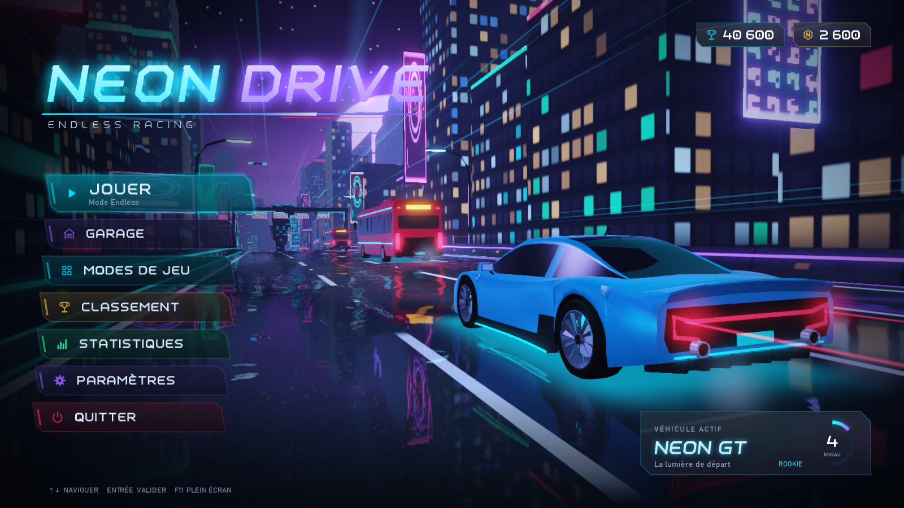

# NEON DRIVE : Endless Racing

Jeu de course arcade futuriste en Python 3.11. Autoroute infinie, huit voitures, cinq univers,
cinq modes et un contrôle gestuel par webcam. Fonctionne hors ligne, sans carte graphique dédiée
(OpenGL 3.3 suffit, par exemple une puce Intel UHD).



## Jouer

Double-cliquez sur `lancer.bat`, ou :

```powershell
.\.venv\Scripts\python.exe main.py
```

Options utiles : `--quality low|medium|high`, `--windowed`, `--no-audio`, `--skip-intro`.

## Installer sur un autre PC

```powershell
powershell -ExecutionPolicy Bypass -File installer.ps1
```

Le script place Python 3.11 dans `.runtime\`, les bibliothèques dans `.venv\`, et ne modifie rien
ailleurs. Une connexion est nécessaire pour cette étape seulement. Si le dossier est copié sur un
autre ordinateur, supprimez `.venv` avant de relancer l'installation (ses chemins sont absolus).

## Commandes

| Action | AZERTY | QWERTY | Manette |
|---|---|---|---|
| Diriger | ← → ou Q D | ← → ou A D | Stick gauche |
| Accélérer / ralentir | ↑ ↓ ou Z S | ↑ ↓ ou W S | Gâchettes |
| Nitro | Espace | Espace | A |
| Pause | Échap ou P | Échap ou P | Start |
| Plein écran / FPS | F11 / F3 | F11 / F3 | |

Toutes les touches se changent dans Paramètres > Commandes. Frôler un véhicule recharge la nitro et
augmente le combo.

### Gestes (mode Gesture)

| Geste | Effet |
|---|---|
| Main vers la gauche ou la droite | Diriger |
| Main ouverte | Accélérer |
| Poing fermé | Ralentir |
| Deux doigts levés | Nitro |
| Deux mains visibles | Volant virtuel (inclinaison) |

La calibration en trois étapes s'ouvre avant la partie. Sensibilité, zone neutre et mode de direction
se règlent dans Paramètres > Gestes. Si les mains disparaissent, la partie se met en pause et reprend
à leur retour ; « Revenir au clavier » est proposé dans la pause.

Confidentialité : les images sont traitées en mémoire puis jetées. MediaPipe est figé en 0.10.32, car
les versions suivantes envoient des statistiques d'usage.

## Contenu

* **Véhicules** : Neon GT, Shadow X, Phantom RS, Thunder V8, Cyber R, Inferno, Velocity, Apex One.
  Vitesse, accélération, maniabilité, résistance et nitro propres ; couleur, jantes, éclairage, nitro et
  traînée personnalisables. Déblocage avec les pièces gagnées en jeu, aucun achat réel.
* **Univers** : Neon City, Desert Highway, Rainy Tokyo, Mountain Road, Cyber Tunnel.
* **Modes** : Endless, Time Attack, Survival, Night, Gesture.
* **Circulation** : berlines, compactes, coupés, roadsters, utilitaires, bus, camions ; quatre tempéraments.
* **Obstacles** : barrières, cônes, travaux, véhicules immobilisés, flaques, débris.
* **Bonus** : nitro, bouclier, aimant, réparation, score ×2, ralenti du trafic.
* **Progression** : niveaux, rangs, 24 succès, classement local, statistiques.

## Architecture

```
main.py               point d'entrée
config/               palette, véhicules, univers, modes, réglages, chemins
core/                 application, scènes et transitions, progression, diagnostic
engine/               rendu OpenGL, shaders, tracé, décor, canevas 2D
  models/             maillages procéduraux (voitures, trafic, objets)
entities/             simulation pure : joueur, trafic, obstacles, collisions, apparition
effects/              particules, traînées, animations, secousses, ralenti
scenes/               intro, menu, modes, garage, jeu, fin, stats, classement, paramètres, calibration
ui/                   composants, HUD, logo, icônes
audio/                mixeur adaptatif et synthétiseur hors ligne
controllers/          clavier et manette, gestes
computer_vision/      webcam, MediaPipe, interprétation des gestes
database/             sauvegarde SQLite
assets/               police, icônes, sons, modèle de main
tools/                fabrication des ressources, captures, mesures
tests/                tests automatiques
```

Choix techniques :

* Pygame-CE gère la fenêtre, les entrées, le son et les polices. Le rendu passe par ModernGL : géométrie
  instanciée, reflets planaires, bloom HDR, FXAA. La route est courbée dans le vertex shader.
* La simulation avance par pas fixes de 1/120 s, donc identique quel que soit le nombre de FPS. Elle ne
  dépend ni de l'écran ni du son, ce qui permet de la tester à grande vitesse.
* Équité : chaque rangée d'obstacles laisse une voie libre, les rangées sont assez espacées pour
  traverser la route, et un véhicule cède quand la circulation ferme les quatre voies.
* La webcam et MediaPipe tournent dans un processus séparé : le jeu n'attend jamais une image.
* Une sauvegarde illisible est renommée, jamais effacée.

Tout est original et généré par le projet : `tools/build_font.py` (police), `tools/build_icons.py` (icônes),
`tools/build_audio.py` (musiques et sons). Le texte courant utilise Bahnschrift, fournie par Windows. Le
modèle `hand_landmarker.task` vient de MediaPipe (licence Apache 2.0).

## Sauvegarde

`data\neon_drive.db` (ou `%LOCALAPPDATA%\NeonDrive` si le dossier est protégé). Journal : `data\neon_drive.log`.
Supprimer la base remet le jeu à zéro.

## Tests

```powershell
powershell -ExecutionPolicy Bypass -File installer.ps1 -Dev
.\.venv\Scripts\python.exe -m pytest -q
.\.venv\Scripts\python.exe tools\e2e_window.py
.\.venv\Scripts\python.exe tools\bench.py medium
.\.venv\Scripts\python.exe main.py --selftest rapport.json --selftest-camera
```

`e2e_window.py` joue dans une vraie fenêtre avec de vrais messages clavier. `--selftest` est un diagnostic
complet, utilisable aussi avec l'exécutable.

Mesures sur Intel Core i7-8650U et UHD 620 (fenêtre 1600 × 900, trafic dense) :

| Profil | Résolution interne | FPS |
|---|---|---|
| Faible (fenêtre 1280 × 720) | 716 × 402 | 60 |
| Moyen | 1152 × 648 | 60 |
| Élevé, résolution dynamique coupée | 1472 × 828 | 50 à 60 |

## Créer l'exécutable

```powershell
powershell -ExecutionPolicy Bypass -File installer.ps1 -Dev
.\.venv\Scripts\python.exe -m PyInstaller neon_drive.spec --noconfirm
```

Résultat : `dist\NeonDrive\NeonDrive.exe`. Distribuez le dossier `NeonDrive` entier (environ 300 Mo).

## Dépannage

* **OpenGL 3.3 requis** : mettez à jour le pilote graphique.
* **Saccades** : Paramètres > Image > qualité FAIBLE, résolution dynamique activée.
* **Webcam introuvable** : Windows > Confidentialité > Caméra, autorisez les applications de bureau, et
  fermez Teams, Zoom ou le navigateur.
